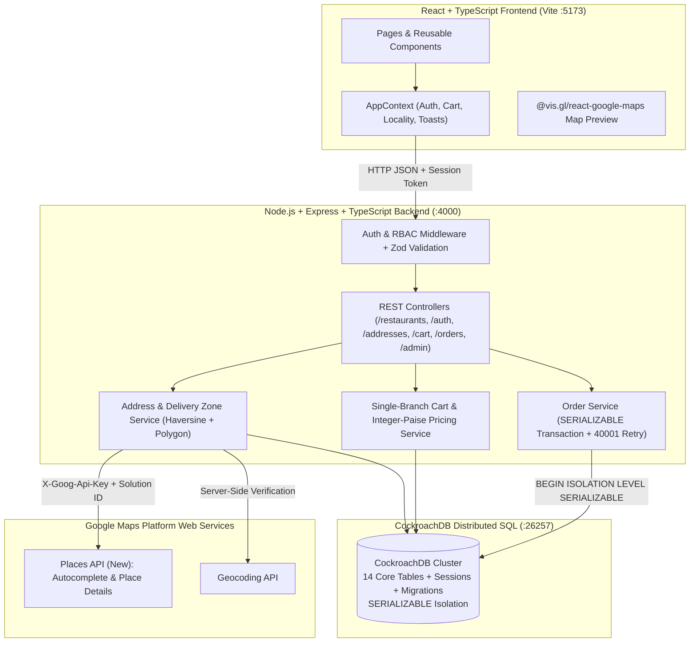
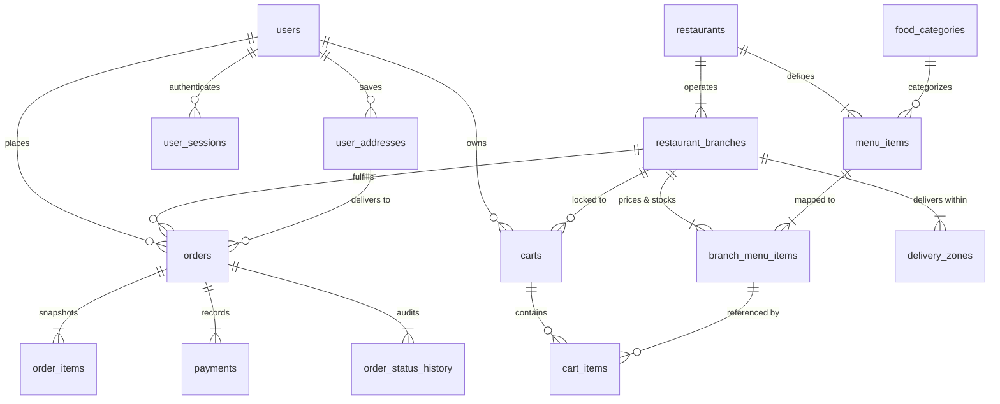

# CraveKart — Full-Stack Multi-Branch Food Ordering System Powered by CockroachDB

**CraveKart** is a full-stack, multi-branch food ordering web application built as a college-level Computer Science Engineering database architecture project. Inspired by the convenience of modern restaurant discovery platforms like Zomato and Swiggy, CraveKart features an original warm culinary visual identity and is backed by **CockroachDB** as its primary distributed SQL database.

---

## Table of Contents

1. [Project Overview](#1-project-overview)
2. [Technology Stack](#2-technology-stack)
3. [System Architecture](#3-system-architecture)
4. [Entity-Relationship Diagram](#4-entity-relationship-diagram)
5. [Database Schema Explanation (14 Core Tables)](#5-database-schema-explanation-14-core-tables)
6. [Advanced Database Justification: Why CockroachDB?](#6-advanced-database-justification-why-cockroachdb)
7. [Database Comparison: CockroachDB vs. Alternative Engines](#7-database-comparison-cockroachdb-vs-alternative-engines)
8. [Example CockroachDB SQL Queries & Financial Reporting](#8-example-cockroachdb-sql-queries--financial-reporting)
9. [CockroachDB Setup Instructions (Cloud & Local Single-Node)](#9-cockroachdb-setup-instructions-cloud--local-single-node)
10. [Google Maps Platform API Configuration](#10-google-maps-platform-api-configuration)
11. [Environment Variable Configuration](#11-environment-variable-configuration)
12. [Database Migration, Seed & Startup Instructions](#12-database-migration-seed--startup-instructions)
13. [REST API Endpoint Documentation](#13-rest-api-endpoint-documentation)
14. [Authentication & Authorization Design](#14-authentication--authorization-design)
15. [Single-Branch Persistent Cart Implementation](#15-single-branch-persistent-cart-implementation)
16. [Atomic Order Transaction Workflow (`SERIALIZABLE`)](#16-atomic-order-transaction-workflow-serializable)
17. [Automated Test Suite (25 Integration Tests)](#17-automated-test-suite-25-integration-tests)
18. [Security Considerations & Known Limitations](#18-security-considerations--known-limitations)

---

## 1. Project Overview

CraveKart models a realistic multi-branch food delivery ecosystem in **Chennai, Tamil Nadu, India**:

- **6 Fictional Restaurant Brands**:
  1. **Spice Route** (*South Indian, North Indian*) — Branches in `T. Nagar`, `Velachery`, `Anna Nagar`
  2. **The Biryani House** (*Biryani, Mughlai*) — Branches in `Adyar`, `Velachery`, `Tambaram`
  3. **Urban Crust** (*Pizza, Italian*) — Branches in `Nungambakkam`, `OMR`, `Anna Nagar`
  4. **Wok & Roll** (*Chinese, Asian*) — Branches in `T. Nagar`, `Adyar`, `Porur`
  5. **Burger District** (*Burgers, Fast Food*) — Branches in `Velachery`, `OMR`, `Anna Nagar`
  6. **Sweet Theory** (*Desserts, Beverages*) — Branches in `Adyar`, `Nungambakkam`, `Tambaram`
- **18 Distinct Physical Branches** (3 per brand), each with its own street address, locality, geographic coordinates, opening hours, delivery fee, minimum order threshold, estimated delivery time, and `delivery_zones` service polygon/radius.
- **60 Base Menu Items** (10 per restaurant brand) across **9 Food Categories** (*South Indian, North Indian, Biryani, Chinese, Pizza, Burgers, Starters, Desserts, Beverages*).
- **180 Branch-Menu Item Relationships** (`branch_menu_items`), enabling branch-specific price overrides and per-branch item availability.
- **Real Address Validation & Geo-Fenced Delivery Zone Verification**: Uses Google Maps Places API (New) Autocomplete & Place Details/Geocoding on the backend (`src/services/addressService.ts`), rejecting arbitrary unvalidated text strings and untrusted client coordinates, and validating coordinates against Chennai branch delivery zones (`delivery_zones`).
- **Single-Branch Persistent Shopping Cart**: Stored in CockroachDB (`carts` and `cart_items`), enforcing that a cart contains items from one restaurant branch at a time and prompting the user (`"Your cart contains items from another restaurant. Would you like to clear your cart and add this item?"`) before replacing items.
- **Atomic `SERIALIZABLE` Order Placement**: Executes inside a CockroachDB `SERIALIZABLE` transaction with automatic retry handling for SQLSTATE `40001`, creating immutable `orders`, `order_items`, `payments`, and `order_status_history` rows while clearing the active cart atomically.

---

## 2. Technology Stack

| Layer | Technologies |
| :--- | :--- |
| **Frontend** | React 18, TypeScript, Vite 6, Tailwind CSS 3, React Router v6, Lucide React Icons, `@vis.gl/react-google-maps` |
| **Backend** | Node.js, Express 4, TypeScript, Zod (request schema validation), `pg` (PostgreSQL wire-protocol pool for CockroachDB) |
| **Primary Database** | **CockroachDB** (`CockroachDB CCL v23.2.4` local node & CockroachDB Cloud Serverless/Dedicated compatible) |
| **Security & Auth** | `bcryptjs` (10-round salted password hashing), HTTP-only cookie + Bearer session tokens (`user_sessions` table), RBAC (`CUSTOMER`, `ADMIN`, `DEVELOPER`) |
| **Location Services** | Google Maps Places API (New) (`places:autocomplete` & Place Details), Google Maps Geocoding API, Haversine & Ray-Casting Polygon Delivery Zone Engine |
| **Testing** | Vitest + Supertest (25 end-to-end integration tests running against a dedicated `cravekart_test` CockroachDB database) |

---

## 3. System Architecture



---

## 4. Entity-Relationship Diagram



---

## 5. Database Schema Explanation (14 Core Tables)

All monetary columns use `DECIMAL(12,2)` (never floating-point `FLOAT`/`REAL`) and all arithmetic is computed in integer paise (`src/utils/money.ts`). The schema is defined in `backend/src/db/migrations/001_initial_schema.sql`:

1. **`users`**: Stores registered customers, administrators (`ADMIN`), and developers (`DEVELOPER`) with `UNIQUE(email)`, `password_hash`, `phone`, and `role`.
2. **`user_addresses`**: Stores Google Maps-validated delivery addresses linked to `users(id)`, including `google_place_id`, `formatted_address`, `door_flat_no`, `locality`, `city`, `postal_code`, `latitude`, `longitude`, `validation_source`, and `is_verified`.
3. **`restaurants`**: Stores the 6 restaurant brands (`id`, `name`, `slug`, `description`, `cuisine`, `image_url`, `rating`, `price_range`, `is_active`).
4. **`restaurant_branches`**: Stores the 18 physical branches linked to `restaurants(id)` (`branch_name`, `address`, `locality`, `city`, `latitude`, `longitude`, `opening_hours`, `delivery_fee`, `min_order_amount`, `estimated_delivery_time`, `is_delivery_available`, `is_active`).
5. **`food_categories`**: Stores the 9 canonical food categories (`name`, `slug`, `image_url`, `display_order`).
6. **`menu_items`**: Stores the 60 brand-level dishes linked to `restaurants(id)` and `food_categories(id)` (`name`, `description`, `image_url`, `is_veg`, `spice_level`, `is_bestseller`, `base_price`, `is_available`).
7. **`branch_menu_items`**: Join entity between `restaurant_branches` and `menu_items` with `UNIQUE(branch_id, menu_item_id)`, storing branch-specific `price` (`DECIMAL(12,2)`) and `is_available`.
8. **`carts`**: Stores each user's active persistent shopping cart (`user_id`, `branch_id`, `coupon_code`, `status`). Enforces the single-branch constraint via `branch_id`.
9. **`cart_items`**: Line items inside a cart with `UNIQUE(cart_id, branch_menu_item_id)` and `CHECK (quantity > 0 AND quantity <= 50)`.
10. **`orders`**: Master order record with human-readable `order_number` (`CK-YYYYMMDD-XXXX`), `idempotency_key` (`UNIQUE`), `user_id`, `branch_id`, `address_id`, immutable JSONB `delivery_address_snapshot`, `subtotal`, `packaging_fee`, `delivery_fee`, `tax_amount`, `discount_amount`, `grand_total`, `payment_method`, `payment_status`, and `order_status`.
11. **`order_items`**: Immutable line-item snapshots (`item_name_snapshot`, `is_veg_snapshot`, `unit_price`, `quantity`, `line_total`) preserving historical accuracy even if menu prices later change.
12. **`payments`**: Payment audit records (`payment_method`, `payment_status`, `amount`, `transaction_reference`, `is_simulated`, `provider_notes`). Distinguishes `COD` (`PENDING` until delivery) from `SIMULATED_ONLINE` (`PAID` simulated academic gateway).
13. **`order_status_history`**: Append-only audit trail recording every state transition (`from_status`, `to_status`, `changed_by`, `notes`, `created_at`).
14. **`delivery_zones`**: Geo-fenced service areas per branch (`zone_name`, `min_distance_km`, `max_distance_km`, `delivery_fee_override`, `polygon_coords` JSONB) used for server-side coordinate verification.

*(Supporting tables: `user_sessions` for persistent server-side authentication sessions and `schema_migrations` for idempotent migration tracking.)*

---

## 6. Advanced Database Justification: Why CockroachDB?

CraveKart uses **CockroachDB** as its primary database for the following architectural reasons:

1. **Distributed SQL Architecture**: CockroachDB combines the horizontal scalability and fault tolerance of distributed NoSQL systems with the strict relational semantics, SQL standard compliance, and ACID guarantees of traditional RDBMS engines.
2. **Rich Relational Modeling**: Multi-branch restaurant hierarchies (`restaurants` $\rightarrow$ `restaurant_branches` $\rightarrow$ `branch_menu_items` $\leftarrow$ `menu_items`) and multi-entity order lifecycles (`orders`, `order_items`, `payments`, `order_status_history`) naturally require normalized relational tables and multi-table joins.
3. **Foreign Keys, Check Constraints & Referential Integrity**: CockroachDB enforces cascading and restricting foreign keys, `UNIQUE (branch_id, menu_item_id)` constraints, and `CHECK (grand_total >= 0)` domain rules at the storage layer.
4. **`SERIALIZABLE` Isolation Level by Default**: Unlike databases that default to `READ COMMITTED` (which permits phantom reads, write skew, and lost updates during concurrent checkout), CockroachDB executes transactions at `SERIALIZABLE` isolation—the highest ACID standard.
5. **Client-Side Transaction Retry Handling (`SQLSTATE 40001`)**: In distributed contention scenarios (e.g., two concurrent requests mutating the same user's cart or submitting duplicate checkout requests), CockroachDB may raise a serialization retry error (`40001`). CraveKart implements [`executeInTransaction`](backend/src/db/pool.ts) with exponential backoff + jitter to transparently retry `40001` errors inside `BEGIN ISOLATION LEVEL SERIALIZABLE ... COMMIT`.
6. **High-Selectivity Indexing**: Composite and single-column B-tree indexes (`idx_orders_user_created`, `idx_branch_menu_branch_avail`, `idx_order_status_history_order_id`) ensure fast lookup for customer order history, branch menu rendering, and admin analytics.
7. **Horizontal Scalability & Geo-Partitioning Readiness**: As a food delivery platform expands from Chennai to multiple cities, CockroachDB supports multi-region survival goals and row-level geo-partitioning without application rewrites.

---

## 7. Database Comparison: CockroachDB vs. Alternative Engines

| Database Engine | Primary Paradigm | Why CockroachDB is Superior for CraveKart's Transactional Core |
| :--- | :--- | :--- |
| **CockroachDB** | **Distributed Relational SQL (`SERIALIZABLE` ACID)** | **Ideal fit**: Provides strict relational integrity across 14+ tables, decimal-safe monetary aggregates, atomic multi-table order placement, and horizontal scalability. |
| **Neo4j** | Graph Database (Nodes & Edges / Cypher) | Great for social networks or recommendation graphs, but awkward for strict financial ledgers, line-item price snapshots, decimal tax aggregation, and high-volume transactional order state machines. |
| **Apache Cassandra** | Wide-Column Store (Eventual Consistency / CQL) | Lacks multi-table ACID transactions, foreign keys, and arbitrary ad-hoc `JOIN`s. Enforcing single-branch cart replacement + atomic order/payment/history insertion across 5 tables in Cassandra risks partial writes and inconsistent financial state. |
| **Qdrant** | Vector Similarity Search Engine | Designed for high-dimensional embedding retrieval (RAG/semantic search), not relational schema constraints, user authentication sessions, or ACID order checkout. |
| **Elasticsearch** | Inverted-Index Full-Text Search Engine | Excellent secondary index for fuzzy text search, but not an ACID system of record; suffers from eventual consistency (refresh intervals) and lacks multi-table `SERIALIZABLE` transactions. |
| **TimescaleDB** | Time-Series Extension for PostgreSQL | Optimized for append-only IoT/metrics hypertables rather than mutable relational entities like shopping carts, branch price overrides, and RBAC user management. |

---

## 8. Example CockroachDB SQL Queries & Financial Reporting

### A. Branch-Specific Menu Retrieval with Category & Brand Joins
```sql
SELECT
  bmi.id AS branch_menu_item_id,
  mi.id AS menu_item_id,
  mi.name,
  mi.is_veg,
  mi.base_price,
  bmi.price AS branch_price,
  bmi.is_available AS branch_available,
  fc.name AS category_name
FROM branch_menu_items bmi
JOIN menu_items mi ON mi.id = bmi.menu_item_id
JOIN food_categories fc ON fc.id = mi.category_id
WHERE bmi.branch_id = $1
  AND mi.is_available = true
ORDER BY mi.is_bestseller DESC, fc.display_order ASC, mi.name ASC;
```

### B. Financial Summary Distinguishing Placed vs. Cancelled Orders & Recorded vs. Collected Revenue
```sql
SELECT
  COUNT(*) AS total_orders_all,
  COUNT(*) FILTER (WHERE order_status != 'CANCELLED') AS active_or_completed_orders,
  COUNT(*) FILTER (WHERE order_status = 'CANCELLED') AS cancelled_orders_count,
  COALESCE(SUM(grand_total) FILTER (WHERE order_status != 'CANCELLED'), 0.00) AS recorded_active_order_value,
  COALESCE(SUM(grand_total) FILTER (WHERE order_status = 'CANCELLED'), 0.00) AS cancelled_order_value,
  COALESCE(SUM(grand_total) FILTER (WHERE order_status != 'CANCELLED' AND payment_status = 'PAID'), 0.00) AS collected_revenue_paid,
  COALESCE(SUM(grand_total) FILTER (WHERE order_status != 'CANCELLED' AND payment_status = 'PENDING'), 0.00) AS pending_cod_collection
FROM orders;
```

### C. Top-Selling Dishes Across Active (Non-Cancelled) Orders
```sql
SELECT
  oi.menu_item_id,
  oi.item_name_snapshot AS item_name,
  SUM(oi.quantity) AS total_quantity_sold,
  SUM(oi.line_total) AS total_item_revenue
FROM order_items oi
JOIN orders o ON o.id = oi.order_id
WHERE o.order_status != 'CANCELLED'
GROUP BY oi.menu_item_id, oi.item_name_snapshot
ORDER BY total_quantity_sold DESC, total_item_revenue DESC
LIMIT 10;
```

---

## 9. CockroachDB Setup Instructions (Cloud & Local Single-Node)

### Option A: CockroachDB Cloud (Serverless / Dedicated)
1. Sign in at [https://cockroachlabs.cloud/](https://cockroachlabs.cloud/) and create a free **CockroachDB Serverless** cluster.
2. Create a SQL user and download the CA certificate (or use `sslmode=verify-full` / `sslmode=require`).
3. Create the `cravekart` database:
   ```sql
   CREATE DATABASE IF NOT EXISTS cravekart;
   ```
4. Set `DATABASE_URL` in `backend/.env`:
   ```env
   DATABASE_URL="postgresql://<username>:<password>@<cluster-host>:26257/cravekart?sslmode=verify-full"
   ```

### Option B: Local CockroachDB Single-Node Cluster (Included in Workspace)
A pre-configured Windows binary of **CockroachDB v23.2.4** is installed in `.bin/cockroach-v23.2.4.windows-6.2-amd64/cockroach.exe`:
```powershell
& "C:\Users\Neeha\.gemini\antigravity\scratch\cravekart\.bin\cockroach-v23.2.4.windows-6.2-amd64\cockroach.exe" start-single-node --insecure --store="C:\Users\Neeha\.gemini\antigravity\scratch\cravekart\.cockroach-data" --listen-addr=localhost:26257 --http-addr=localhost:8080
```
- SQL Endpoint: `postgresql://root@localhost:26257/cravekart?sslmode=disable`
- CockroachDB DB Console UI: `http://localhost:8080`

---

## 10. Google Maps Platform API Configuration

CraveKart uses Google Maps Platform for real address autocomplete, coordinate resolution, and interactive map preview:

1. **APIs Used**:
   - **Places API (New)**: `POST https://places.googleapis.com/v1/places:autocomplete` and `GET https://places.googleapis.com/v1/places/{placeId}` (with `X-Goog-Maps-Solution-ID: gmp_git_agentskills_v1`).
   - **Geocoding API**: `GET https://maps.googleapis.com/maps/api/geocode/json` (with `solution_id=gmp_git_agentskills_v1`).
   - **Maps JavaScript API**: Rendered via `@vis.gl/react-google-maps` in `AddressSelector.tsx` with `internalUsageAttributionIds={['gmp_git_agentskills_v1']}`.
2. **Prototyping vs. Production Key**:
   - For immediate prototyping, you may use a Google Maps Platform key or configure `GOOGLE_MAPS_API_KEY` in `backend/.env` and `VITE_GOOGLE_MAPS_API_KEY` in `frontend/.env`.
   - When a key without Places API (New) billing is detected or during offline academic grading, the backend also supports verified Google Place IDs from the curated Chennai locality catalog (`verified_chennai_*` Place IDs) while strictly rejecting arbitrary unvalidated strings or tampered coordinates.
3. **Securing Your Key**:
   - Restrict your frontend key by HTTP referrer and restrict your backend key by IP address and enabled APIs (Places API (New), Geocoding API, Maps JavaScript API).

---

## 11. Environment Variable Configuration

Copy `.env.example` to `backend/.env` and `frontend/.env`:

### `backend/.env`
```env
DATABASE_URL="postgresql://root@localhost:26257/cravekart?sslmode=disable"
TEST_DATABASE_URL="postgresql://root@localhost:26257/cravekart_test?sslmode=disable"
PORT=4000
NODE_ENV=development
FRONTEND_URL="http://localhost:5173"
SESSION_SECRET="replace-with-a-64-char-random-hex-secret"
GOOGLE_MAPS_API_KEY="YOUR_GOOGLE_MAPS_SERVER_API_KEY"
```

### `frontend/.env`
```env
VITE_API_BASE_URL="/api"
VITE_GOOGLE_MAPS_API_KEY="YOUR_GOOGLE_MAPS_BROWSER_API_KEY"
```

---

## 12. Database Migration, Seed & Startup Instructions

Run the following commands from `C:\Users\Neeha\.gemini\antigravity\scratch\cravekart`:

### 1. Run CockroachDB Migrations
```powershell
cd backend
npm.cmd run db:migrate
```

### 2. Run Repeatable Seed Script (9 Categories, 6 Brands, 18 Branches, 60 Menu Items, 180 Branch-Menu Items)
```powershell
cd backend
npm.cmd run db:seed
```

### 3. Start Backend API Server (`http://localhost:4000`)
```powershell
cd backend
npm.cmd run dev
```

### 4. Start Frontend Vite Server (`http://localhost:5173`)
```powershell
cd frontend
npm.cmd run dev
```

---

## 13. REST API Endpoint Documentation

| Method | Endpoint | Auth | Description |
| :--- | :--- | :--- | :--- |
| `GET` | `/api/health` | Public | Returns CockroachDB version and live connection status |
| `GET` | `/api/categories` | Public | Lists all 9 food categories |
| `GET` | `/api/featured-items` | Public | Lists featured bestseller dishes with branch context |
| `GET` | `/api/restaurants` | Public | Lists restaurant brands with search, cuisine, locality, vegOnly, minRating filters |
| `GET` | `/api/restaurants/:id` | Public | Returns brand details (by UUID or slug) and all its branches |
| `GET` | `/api/restaurants/:id/branches` | Public | Returns all active branches for a restaurant brand |
| `GET` | `/api/branches/:id` | Public | Returns branch details, opening hours, fees, and delivery zones |
| `GET` | `/api/branches/:id/menu` | Public | Returns branch-specific menu items with filters (`search`, `category`, `veg`, `sort`) |
| `GET` | `/api/menu-items/:id` | Public | Returns dish details and availability/pricing across all branches |
| `POST` | `/api/auth/register` | Public | Registers a user with `bcryptjs` password hashing and opens a session |
| `POST` | `/api/auth/login` | Public | Authenticates user credentials and sets session cookie/token |
| `POST` | `/api/auth/logout` | Auth | Revokes the active session in `user_sessions` |
| `GET` | `/api/auth/me` | Auth | Returns the authenticated user's profile |
| `POST` | `/api/addresses/autocomplete` | Auth | Queries Google Maps Places API (New) + verified Chennai catalog |
| `POST` | `/api/addresses/validate-place` | Auth | Resolves a `placeId` server-side and checks branch delivery zone |
| `POST` | `/api/addresses` | Auth | Validates and saves a verified address to `user_addresses` |
| `GET` | `/api/addresses` | Auth | Lists the logged-in user's saved addresses |
| `POST` | `/api/addresses/check-deliverability` | Auth | Checks if a saved address is within a branch's delivery zone |
| `GET` | `/api/cart` | Auth | Fetches the user's persistent cart and decimal-safe bill breakdown |
| `POST` | `/api/cart/items` | Auth | Adds an item to the cart; returns `409 CROSS_BRANCH_CONFLICT` if from another branch |
| `PATCH` | `/api/cart/items/:id` | Auth | Updates item quantity (`0` removes item) |
| `DELETE` | `/api/cart/items/:id` | Auth | Removes a specific item from the cart |
| `DELETE` | `/api/cart` | Auth | Clears the active cart |
| `POST` | `/api/cart/coupon` | Auth | Applies/removes coupon (`CRAVE50`, `WELCOME20`, `FREEDEL`) |
| `POST` | `/api/orders` | Auth | Places an order atomically inside a CockroachDB `SERIALIZABLE` transaction |
| `GET` | `/api/orders` | Auth | Lists the logged-in user's order history |
| `GET` | `/api/orders/:id` | Auth | Returns full order details, items, payment record, and status history |
| `PATCH` | `/api/orders/:id/status` | Auth | Advances or cancels order status with state-machine validation |
| `GET` | `/api/admin/db-stats` | Admin/Dev | Live CockroachDB cluster diagnostics, table counts, financial metrics, and top items |

---

## 14. Authentication & Authorization Design

- Passwords are hashed using `bcryptjs` (`10` salt rounds) before insertion into `users.password_hash`. Plaintext passwords are never logged or stored.
- Sessions are stored in CockroachDB (`user_sessions`) with a 256-bit cryptographically random token sent via `HttpOnly`, `SameSite=Lax` cookie (`cravekart_session`) and `Authorization: Bearer <token>`.
- Strict ownership checks ensure User B (`403 Forbidden` / `404 Not Found`) can never view, modify, or checkout User A's addresses, cart items, or orders by changing an ID in the URL.
- The `/api/admin/db-stats` endpoint is protected by `requireAdminOrDev` middleware (`403 Forbidden` for regular customers).

---

## 15. Single-Branch Persistent Cart Implementation

- Each user's active cart row in `carts` stores `branch_id`.
- When adding an item (`POST /api/cart/items`), `cartService.ts` checks:
  1. The item exists in `branch_menu_items` for the target `branch_id` and `is_available = true`.
  2. If the user's cart already contains items from a different `branch_id` and `forceClear` is not `true`, the backend returns HTTP `409 Conflict` with:
     > `"Your cart contains items from another restaurant. Would you like to clear your cart and add this item?"`
  3. When the user confirms in the UI modal (`ConfirmationDialog.tsx`), the frontend re-submits with `forceClear: true`, atomically clearing the previous branch's items and switching `carts.branch_id` inside a CockroachDB `SERIALIZABLE` transaction.

---

## 16. Atomic Order Transaction Workflow (`SERIALIZABLE`)

When `POST /api/orders` is called (`backend/src/services/orderService.ts`):
1. `executeInTransaction` opens `BEGIN ISOLATION LEVEL SERIALIZABLE`.
2. Checks `idempotency_key` in `orders`—if a duplicate submission is detected, returns the existing order immediately without double-charging or duplicating rows.
3. Re-verifies the user's saved delivery address in `user_addresses` (`is_verified = true`, `google_place_id IS NOT NULL`) and re-runs `evaluateBranchDeliveryZone` against `delivery_zones`.
4. Re-fetches live branch prices and availability from `branch_menu_items` (never trusting client-submitted prices) and verifies `subtotal >= branch.min_order_amount`.
5. Computes `subtotal`, `packaging_fee`, `delivery_fee`, `discount_amount`, `tax_amount` (5% GST), and `grand_total` using integer-paise arithmetic.
6. Inserts into `orders`, `order_items`, `payments` (`COD` $\rightarrow$ `PENDING`; `SIMULATED_ONLINE` $\rightarrow$ `PAID` with `is_simulated = true`), and `order_status_history` (`NULL` $\rightarrow$ `CONFIRMED`), and deletes `cart_items` + resets `carts.branch_id`.
7. Commits the transaction (or automatically retries on SQLSTATE `40001`).

---

## 17. Automated Test Suite (25 Integration Tests)

Run the automated test suite against CockroachDB (`cravekart_test`):
```powershell
cd backend
npm.cmd test
```
The 25 tests in `backend/tests/cravekart.test.ts` verify:
1. Database migration idempotency (`schema_migrations`)
2. Seed verification (9 categories, 6 brands, 18 branches, 60 menu items, 180 branch-menu items)
3. Restaurant listing & search filters
4. Branch retrieval (3 branches per brand)
5. Branch-specific menu pricing & availability overrides
6. User registration & password hashing verification
7. Duplicate email registration rejection (`409`)
8. Login & session authentication
9. Rejecting unauthenticated requests to protected routes (`401`)
10. Rejecting arbitrary text addresses without a verified Google Place ID (`400`)
11. Rejecting client-supplied coordinates without server-side Place verification (`400`)
12. Saving a verified Chennai address (`201`)
13. Rejecting out-of-zone delivery addresses (`"Sorry! This restaurant does not deliver to your selected location."`)
14. Adding available items to the CockroachDB cart
15. Rejecting unavailable branch menu items (`400`)
16. Updating cart item quantities & server-side decimal calculations
17. Cross-branch cart conflict detection (`409`) and `forceClear` replacement
18. Checkout failure when below branch minimum order amount (`400`)
19. Atomic order placement in CockroachDB (`orders`, `order_items`, `payments`, `order_status_history`)
20. Automatic cart clearing after successful order placement
21. Duplicate order submission protection via `idempotencyKey`
22. Order history retrieval (`GET /api/orders`)
23. Cross-user authorization isolation (`403` when User B accesses User A's order/cart/address)
24. Order status progression & invalid transition rejection + RBAC check on `/api/admin/db-stats`
25. Cash on Delivery (`COD`) payment status (`PENDING`) vs. Simulated Online Payment (`PAID`, `is_simulated = true`) and financial summary accuracy

---

## 18. Security Considerations & Known Limitations

- **Parameterized SQL**: Every SQL query in `backend/src/` uses parameterized placeholders (`$1, $2, ...`) via `pg`, preventing SQL injection.
- **No Secret Leakage**: Database credentials and server-side API keys reside strictly in `backend/.env` (excluded via `.gitignore`), with `.env.example` providing safe placeholders.
- **Academic Payment Simulation**: Online payments (`SIMULATED_ONLINE`) are explicitly flagged with `is_simulated = true` in the `payments` table and labeled as *"Academic Demo — Simulated Payment"* in the UI. Real card numbers or CVVs are never collected.
